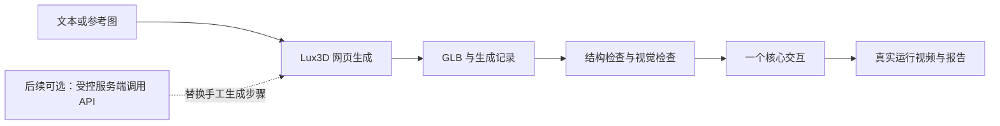

# 初始架构 · 未锁定产品技术栈

2026-11-05 用户已锚定 3D 花束制作。首个原型采用浏览器工作台候选路线，验证独立花材载入、逐枝摆放和旋转查看。实施顺序见 项目内部 kickoff 文档，具体依赖在开发时确定。

## 先走通的一条路径

现在已经实现：资料归档脚本、PPT 文字和备注提取、GLB 结构检查。其余节点是后续开发设计，尚未接入 Lux3D 或生成真实资产。

## 模块职责

| 模块 | 输入 → 输出 | 当前落点 |
| --- | --- | --- |
| 资料整理 | 用户提供的原件 → 本地副本、哈希、页码摘录 | `scripts/ingest_training.py`、`materials/private/` |
| 生成与资产登记 | 提示词或图 → 任务证据、模型与来源记录 | 初期官方网页操作，登记到 `assets/local/` |
| 资产检查 | GLB → 封装、属性与材质摘要；另做实际视觉检查 | `scripts/inspect_glb.py` |
| 交互展示 | 经过检查的花材 → 可逐枝搭配的工作台 | 起步在 `app/` 验证，当前为准备阶段 |
| 提交准备 | 真实体验与迭代记录 → 报告、视频或长期有效链接 | `deliverables/` |

## 选型原则

- 单物体、Mesh 与 PBR 交互：优先验证浏览器 3D 路线。Three.js 是候选，正式选用时核对现行文档并固定依赖。
- 需要 3DGS 空间与 Mesh 混合场景：再试 Aholo Viewer；不要只凭扩展名把 PLY 当普通点云处理。
- 首轮采用 GLB 的 glTF 约定（米、Y-up）；场景转换统一在载入边界完成。任何缩放、转轴、落地都记录，避免重复转换。
- 若物件只需点击与旋转，先不引入骨骼、物理引擎或复杂碰撞。
- 手工生成可以建立核心闭环。只有需要实时生成或批量处理时，再增加服务端 API 模块；不把长期 API key 放进网页代码。

## 后续 API 边界（仅设计）

2026-11-02 已读取官方 [OpenAPI JSON](https://labs.aholo3d.cn/api-docs/openapi.json)。生产入口为 `https://api.aholo3d.cn`；官方简介说明使用 `Authorization: <API key>`，不额外加 Bearer。具体接口的安全定义和请求字段以现行 OpenAPI 为准。

- Lux3D 文生 3D：`POST /lux3d/v1/generate/text-to-3d/task/create`。
- Lux3D 图生 3D：`POST /lux3d/v1/generate/img-to-3d/task/create`。
- Lux3D 查询：`GET /lux3d/v1/generate/task/get`。请求参数和状态枚举在真正编写适配器前按 OpenAPI 核对；不要猜测字段。
- Lux3D 返回 `taskId`，World 流程使用 `worldId`；采用独立适配，禁止混用。
- 应用内部可归一为 `pending/running/succeeded/failed/timed_out`，这不是官方接口枚举。保留供应方原始状态，成功但文件下载失败时单独记录交付状态。
- 创建请求先保存意图和已返回的任务号；查询可限频重试，创建请求网络超时不能直接假定未创建并重发。超时不等于上游取消。
- 先明确单次和单日额度、并发上限、停止条件，再开始可能消耗积分的调用。

## 验收顺序

1. 文件结构可读，来源和生成记录完整。
2. 目标查看器实际加载成功，检查材质、背面、尺度与朝向。
3. 核心交互可重复完成，失败时给出可理解反馈。
4. 真实运行画面与报告描述匹配，交付材料可访问。

培训中的 Viewer 材质与动画行为含讲者对当时本地包的实测，不是永久 API 保证。备注还明确部分截图未经逐张人工目检，因此不能直接把它们当成本项目已验证结果。
